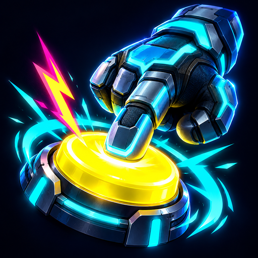
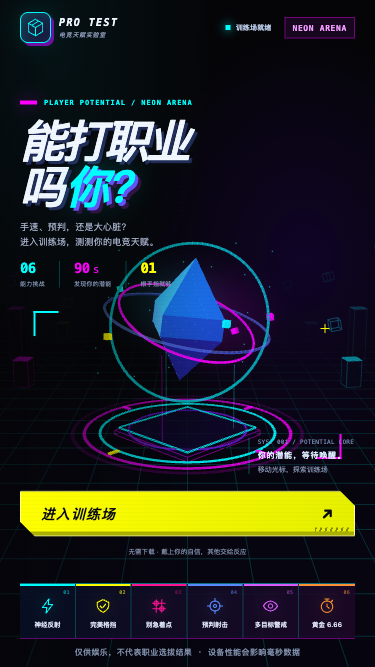
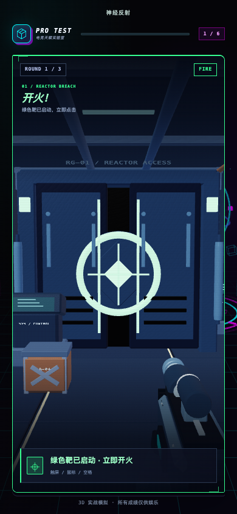
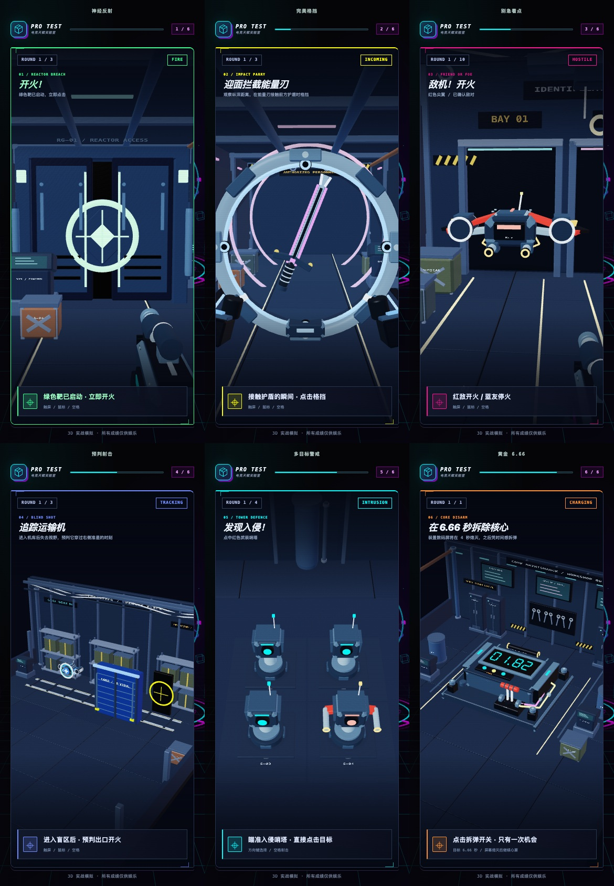
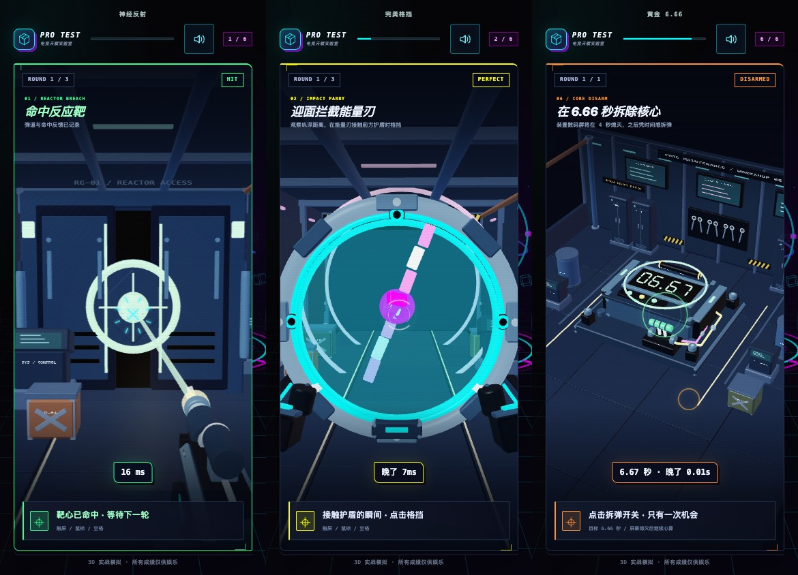

<div align="center">
  

  # 能打职业吗你？

  用约 90 秒测测你的电竞天赋。
</div>

「能打职业吗你？」是一款面向手机端的零依赖 3D 网页小游戏。当前版本为 **v1.4.0**。玩家在六个独立的 3D 场景中完成开火、格挡、敌我识别、盲区预判、哨塔点选和拆弹，测试反应、判断、时机、预判和专注等能力，最后生成一张可分享的电竞天赋报告。

> 本项目仅供娱乐，不代表真实的职业电竞选拔结果。

## 界面预览

以下为界面预览与本地生成的成绩卡示例。

新版品牌素材：[1:1 Logo](docs/assets/brand-v1.4.0/logo-1x1.png) · [3:4 封面](docs/assets/brand-v1.4.0/cover-3x4.png) · [生成说明](docs/assets/brand-v1.4.0/prompts.md)。

<table>
  <tr>
    <td align="center"><strong>开始测试</strong></td>
    <td align="center"><strong>关卡挑战</strong></td>
    <td align="center"><strong>成绩卡</strong></td>
  </tr>
  <tr>
    <td></td>
    <td></td>
    <td></td>
  </tr>
</table>

### 六关 3D 实战



开火命中、完美格挡和拆弹成功的即时反馈：



## 玩法

| 关卡 | 3D 场景与操作 |
| --- | --- |
| 神经反射 | 盯住走廊闸门，绿色能量靶亮起后点击开火；提前点击算抢跑，亮起 5 秒仍未开火则本关超时。 |
| 完美格挡 | 能量刃从远处迎面飞来，在它接触前方护盾的一瞬间点击格挡。 |
| 别急着点 | 机库中的红色尖翼无人机是敌机，点击开火；蓝色带十字无人机是友机，忍住停火。 |
| 预判射击 | 观察运输机速度，在它进入蓝色机库失去视野后，预判它穿过右侧出口准星的时刻开火。 |
| 多目标警戒 | 扫描不同纵深的 4、6、9、12 座哨塔，直接点中变红并展开武器的入侵者；每轮有 2200ms。键盘可用方向键选中，空格开火。 |
| 黄金 6.66 | 在实体核心数码屏上观察计时，尽量在 6.66 秒点击拆弹；4 秒后数字熄灭，10 秒未拆弹则失败。 |

除需要瞄准哨塔的警戒关外，点击测试视口任意位置即可操作；触屏、鼠标、空格和回车均可使用。完成全部关卡后，游戏会生成职业指数、五维能力评分和本地成绩卡。在小红书小工具环境中，可以通过原生 JSBridge 保存成绩卡或打开图文发布页。

## 3D 训练场与实战关卡

v1.4.0 将六关的可操作目标放进各自的 3D 场景，使用透视相机、实体几何、光照、遮挡和命中反馈呈现挑战。首页保留霓虹训练场，关卡采用独立的大幅游戏视口，提示与操作说明位于画面上下方。

- `game/arena3d.js` 渲染首页、说明页与成绩页背景；进入操作关卡后暂停，避免同时运行两个背景渲染循环。
- `game/stage-engine.js` 提供原生 WebGL 几何渲染、相机投影与 Canvas 兼容回退；`game/stage-scenes.js` 定义六关场景、实体目标与哨塔拾取。
- `game/stage-art.js` 构建工业走廊、机库、物流间、防御区和维修工作间；`game/stage-models.js` 提供装甲步枪、无人机、哨塔、机械盾和拆弹台。
- 关卡采用全幅视口与近景构图，模型包含倒角装甲、圆柱部件、独立指示灯、线缆、螺钉和三维字牌；材质加入粗糙度、距离雾与接触阴影，支持实例合批。
- `game/stage-styles.css` 负责关卡视口与 HUD 布局，`game/styles.css` 负责首页、说明页和成绩页。
- 开火、命中、格挡与拆弹各有独立音效和即时动画：枪口闪光、短后坐、金属火花、护盾冲击环、断刃和拆弹机械动作。声音由本地 Web Audio 合成，顶部开关保存静音偏好，切到后台即停止。
- 计时使用 `performance.now()`，画面由 `requestAnimationFrame()` 推进；渲染与命中判定共享时间和位置参数，输入时冻结并重绘实际位置。
- 多目标警戒改为真实点选，速度评分锚点同步调整；其余关卡保留原评分锚点。完整规则见 [`game/README.md`](game/README.md)。
- WebGL 不可用或上下文丢失时，关卡切换为 Canvas 立体投影回退，保留六个场景及哨塔拾取。
- 所有脚本、样式、模型和字牌纹理均在本地生成，无 Three.js，不加载外部模型、图片、字体或 CDN，离线打开和 ZIP 打包均无需联网。
- 系统“减少动态效果”设置只减少非必要背景运动，关卡中的时机、目标变化和操作反馈仍然保留。

## 本地运行

项目没有第三方运行时依赖。你可以直接打开 [`game/index.html`](game/index.html)，也可以启动一个本地静态服务器：

```bash
npm run dev
```

然后访问 `http://127.0.0.1:4173`。

## 校验与打包

运行静态校验：

```bash
npm run check
```

生成可上传到小红书小工具的离线 ZIP：

```bash
npm run package
```

产物写入 `dist/pro-test-game-<version>-xhs-minitool.zip`。`index.html` 会直接位于 ZIP 根目录，`dist/` 默认不纳入 Git。

## 项目结构

```text
.
├── game/                  # 当前版本（v1.4.0）的可运行源码
│   ├── arena3d.js         # 首页等页面的 3D 训练场背景
│   ├── mini-compat.js     # Flex间距行为检测、旧WebView视口回退
│   ├── mini-storage.js    # 平台Storage优先、低版本回退与缓存迁移
│   ├── stage-engine.js    # WebGL 渲染、投影与 Canvas 回退
│   ├── stage-art.js       # 工业基地环境、设施和静态道具
│   ├── stage-models.js    # 武器、无人机、哨塔和拆弹装置
│   ├── stage-scenes.js    # 六关 3D 场景和目标拾取
│   ├── stage-styles.css   # 关卡视口与 HUD
│   ├── game-audio.js      # 本地音效、手势启用与静音偏好
│   ├── impact-feedback.js # 打击闪光、标记、冲击环和短震动
│   ├── impact-styles.css  # 动作反馈与音效开关样式
│   ├── styles.css         # 首页、说明页与成绩页样式
│   └── game.js            # 游戏流程、计时、评分与分享
├── archive/               # 尚未有 Git 历史前保留的旧版本源码
├── docs/
│   ├── assets/            # README 使用的公开图片素材
│   └── PRODUCT_SPEC.md    # 原始产品需求文档
├── scripts/               # 本地开发、静态校验与打包脚本
├── VERSION                # 当前发布版本
├── package.json           # 零依赖命令入口
└── LICENSE                # MIT License
```

本地打包产物、Playwright 运行记录、Codex 配置和未采用的设计草稿已通过 `.gitignore` 排除。

## 版本

- `v1.4.0`：六关升级为独立 3D 实战场景；新增实体敌我识别、哨塔点选、护盾格挡和核心拆弹，调整专注评分锚点，提供 Canvas 场景回退。
- `v1.3.0`：升级为原生 WebGL 3D 训练场，保留六关玩法与评分，并提供兼容回退和减少动态效果支持。
- `v1.2.1`：更新项目 Logo 与界面预览，并归档未采用的设计方案。
- `v1.2.0`：使用小红书原生相册接口保存成绩卡，并完善失败反馈。
- `v1.1.0`：增加超时自动跳过、进度恢复、键盘支持和更稳定的计时。
- `v1.0.0`：首个 6 关公开版本。

历史版本的详细说明见 [`archive/`](archive/)，当前实现说明见 [`game/README.md`](game/README.md)。

## 隐私与兼容性

- 游戏完全在本地运行，不请求网络、不上传测试数据。
- 客户端 9.46+ 且能力可用时，进度与音效偏好优先保存到平台 Storage；旧客户端和普通浏览器分别回退到 `sessionStorage` 与 `localStorage`。平台首次无数据时可迁移旧缓存，所有存储均容忍失败或被清理。
- 音频能力不可用时，游戏仍可正常进行。
- 小红书专属能力均带存在性判断；普通浏览器仍可完成游戏。
- 优先使用 WebGL 渲染；不可用时使用 Canvas 立体投影回退，保留关卡、计时、评分和目标点选。
- 页面针对手机竖屏设计，同时支持鼠标、空格和回车；多目标警戒还支持方向键选择目标。
- 直接交付的脚本通过 ES2017 解析门禁，CSS 提供 Chrome 61 基线回退。普通浏览器开发回归不能替代小工具验收；创服平台模拟器、Android 真机扫码、iOS 真机扫码，以及旧内核兼容性与真机性能均需使用最终 ZIP 单独验证。

## 参与贡献

欢迎提交 Issue 或 Pull Request。开始前请阅读 [`CONTRIBUTING.md`](CONTRIBUTING.md)。安全问题请按 [`SECURITY.md`](SECURITY.md) 中的方式反馈。

## License

本项目基于 [MIT License](LICENSE) 开源。
