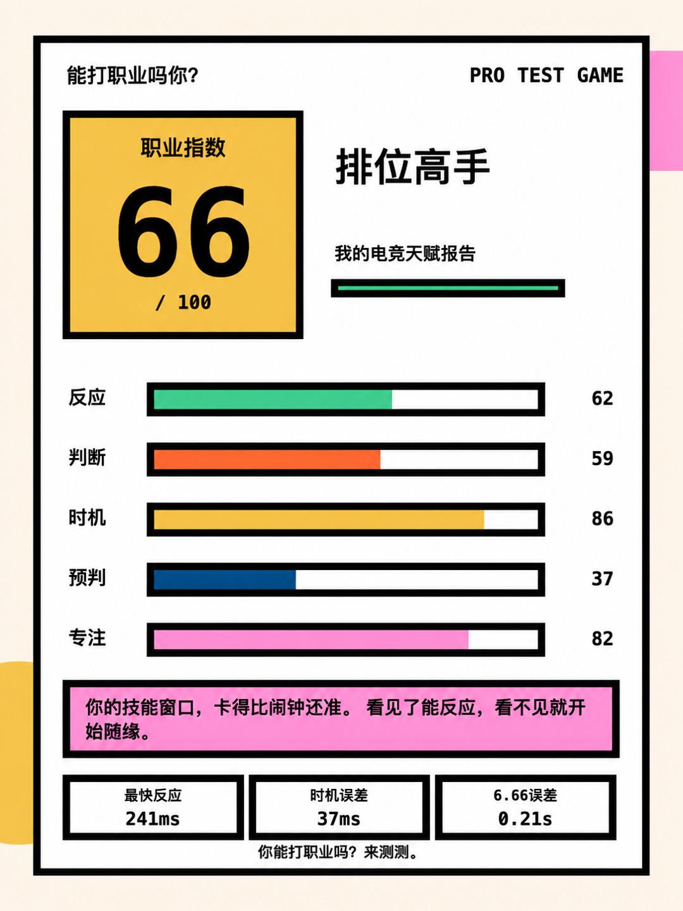

<div align="center">
  

  # 能打职业吗你？

  用约 90 秒测测你的电竞天赋。
</div>

「能打职业吗你？」是一款面向手机端的零依赖网页小游戏。玩家通过 6 个单指点击关卡，测试反应、判断、时机、预判和专注等能力，最后生成一张可分享的电竞天赋报告。

> 本项目仅供娱乐，不代表真实的职业电竞选拔结果。

## 玩法

- 神经反射：看到绿色后尽快点击。
- 完美格挡：在移动指针进入目标区域时点击。
- 别急着点：根据文字和颜色判断是否应该点击。
- 预判射击：预判移动目标到达准星的时机。
- 多目标警戒：发现并点击突然出现的目标。
- 黄金 6.66：在看不到后半程数字的情况下停在 6.66 秒。

完成全部关卡后，游戏会生成职业指数、五维能力评分和本地成绩卡。在小红书小工具环境中，可以通过原生 JSBridge 保存成绩卡或打开图文发布页。



## 本地运行

项目没有第三方运行时依赖。你可以直接打开 [`game/index.html`](game/index.html)，也可以启动一个本地静态服务器：

```bash
npm run dev
```

然后访问 `http://127.0.0.1:4173`。

## 校验与打包

运行静态校验：

```bash
npm run check
```

生成可上传到小红书小工具的离线 ZIP：

```bash
npm run package
```

产物写入 `dist/pro-test-game-<version>-xhs-minitool.zip`。`index.html` 会直接位于 ZIP 根目录，`dist/` 默认不纳入 Git。

## 项目结构

```text
.
├── game/                  # 当前版本（v1.2.0）的可运行源码
├── archive/               # 尚未有 Git 历史前保留的旧版本源码
├── docs/
│   ├── assets/            # README 使用的公开图片素材
│   └── PRODUCT_SPEC.md    # 原始产品需求文档
├── scripts/               # 本地开发、静态校验与打包脚本
├── VERSION                # 当前发布版本
├── package.json           # 零依赖命令入口
└── LICENSE                # MIT License
```

本地打包产物、Playwright 运行记录、Codex 配置和未采用的设计草稿已通过 `.gitignore` 排除。

## 版本

- `v1.2.0`：使用小红书原生相册接口保存成绩卡，并完善失败反馈。
- `v1.1.0`：增加超时自动跳过、进度恢复、键盘支持和更稳定的计时。
- `v1.0.0`：首个 6 关公开版本。

历史版本的详细说明见 [`archive/`](archive/)，当前实现说明见 [`game/README.md`](game/README.md)。

## 隐私与兼容性

- 游戏完全在本地运行，不请求网络、不上传测试数据。
- 测试进度只保存在当前标签页的 `sessionStorage` 中。
- 小红书专属能力均带存在性判断；普通浏览器仍可完成游戏。
- 页面针对手机竖屏设计，同时支持鼠标、空格和回车操作。

## 参与贡献

欢迎提交 Issue 或 Pull Request。开始前请阅读 [`CONTRIBUTING.md`](CONTRIBUTING.md)。安全问题请按 [`SECURITY.md`](SECURITY.md) 中的方式反馈。

## License

本项目基于 [MIT License](LICENSE) 开源。
